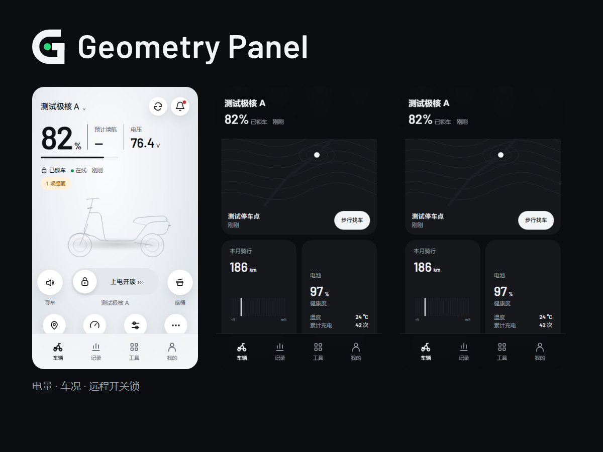

# 几何面板

极核电动车的第三方车控工具。查看电量和车况、远程开关锁、寻车、看停车位置，没有广告。

[打开网页版](https://bedlatess.github.io/GeometryPanel/) · [下载 Android](https://github.com/bedlatess/GeometryPanel/releases/latest) · [iOS 自签安装包](https://github.com/bedlatess/GeometryPanel/releases/latest)

## 能做什么

- 电量、续航、锁状态一眼看清，数据旧了会明确提示
- 滑动开关锁、鸣笛寻车、打开座桶
- 停车位置和步行找车
- 骑行记录、电池和充电记录、胎压
- 多账号、多车切换
- 车况体检、保养提醒、官方充放电记录与电池评分
- 钥匙管理、电子围栏、充电计划、家人车辆分享（随车型显示）
- Android / iOS App：蓝牙钥匙、桌面组件、后台提醒、仪表壁纸与投屏

## 安装

- iPhone：用 Safari 打开网页版 → 分享 → 添加到主屏幕
- Android：下载 APK 安装
- iOS App：下载 IPA 自行签名安装（需要桌面组件时用 widget 版）

## 隐私

- 账号和车辆信息只加密保存在这台设备上。
- 车辆数据直接从极核服务器读取，不经过本项目的服务器（本项目没有服务器）。
- 只有你点开地图时，才会把停车位置发给高德地图。
- 删除账号或退出全部，会清除本机保存的信息。

## 声明

几何面板是车主自发维护的第三方工具，与极核（ZEEHO）及其关联公司没有关联。车辆控制通过极核官方服务完成，执行结果以车辆实际状态为准。使用本工具产生的风险由使用者自行承担。极核、ZEEHO 为其所有者的商标。

## 开发

见 [docs/dev/](docs/dev/)。

## 许可证

[MIT](LICENSE)，仅覆盖本项目原创代码；第三方资源遵循各自许可。
